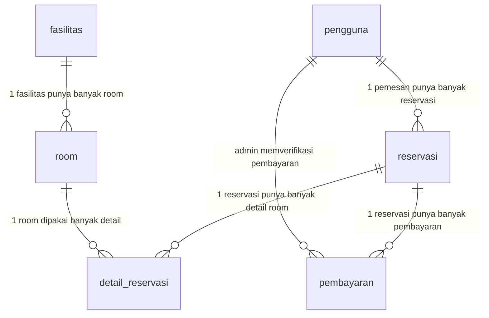
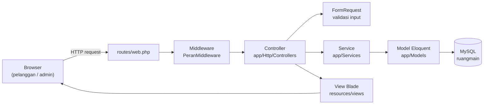
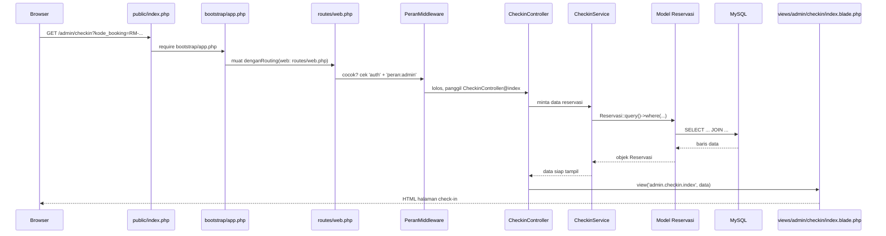

# DOKUMENTASI TEKNIS — RUANGMAIN

Sistem reservasi penyewaan room game berbasis web (Laravel 13 + MySQL).

Dokumen ini menjelaskan alat yang dipakai, bahasa pemrograman, framework/library,
implementasi database (dengan bukti query asli), dan struktur project.

> Semua versi, query, dan hasil query di dokumen ini diambil langsung dari mesin
> pengembangan (bukan contoh). Struktur folder dan daftar file lengkap ada di
> [PROJECT_STRUCTURE.md](PROJECT_STRUCTURE.md).

---

## 1. Software Tools

### 1.1 Alat dan versinya

| No | Alat | Versi | Keterangan |
|----|------|-------|------------|
| 1 | Bahasa program | PHP 8.4.13RC1 | CLI, NTS, Visual C++ 2022 x64, Zend Engine v4.4.13RC1 |
| 2 | Database | MySQL 8.4.3 | MySQL Community Server for Win64 |
| 3 | Package installer (PHP) | Composer 2.8.12 | rilis 2025-09-19 |
| 4 | Package installer (JS) | npm 10.9.3 | Node.js v22.18.0 |
| 5 | Text editor | Visual Studio Code 1.145.2 | lihat daftar ekstensi di 1.3 |
| 6 | Sistem operasi | Windows 11 Home Single Language | build 10.0.26200 |
| 7 | Web server lokal | Laragon 6.0.0 | Apache/Nginx, alamat `http://localhost:8000` |
| 8 | Version control | Git 2.50.1.windows.1 | — |

### 1.2 Ekstensi PHP yang dipakai

Diaktifkan di `php.ini` dan dipakai langsung oleh aplikasi:

| Ekstensi | Dipakai untuk |
|----------|---------------|
| `pdo_mysql` | Koneksi ke database MySQL (driver utama) |
| `mbstring` | Pengolahan string UTF-8 (nama fasilitas, komentar) |
| `openssl` | HTTPS, enkripsi, tanda tangan callback Midtrans |
| `curl` | Request HTTP ke API Midtrans |
| `json` | Baca/tulis payload JSON (callback, konfigurasi) |
| `fileinfo` | Deteksi tipe file upload foto fasilitas |
| `gd` | Pengolahan gambar (QR code) |
| `bcmath` | Perhitungan uang presisi tinggi |
| `intl` | Format tanggal/angka lokal |
| `dom`, `tokenizer` | Dipakai internal Laravel & PHPUnit |
| `pdo_sqlite`, `sqlite3` | Cadangan koneksi (database tes tetap MySQL) |

### 1.3 Ekstensi Visual Studio Code

| Ekstensi | Versi | Fungsi |
|----------|-------|--------|
| `xdebug.php-debug` | 1.40.2 | Debug PHP (breakpoint, watch) |
| `bradlc.vscode-tailwindcss` | 0.16.0 | Autocomplete & cek class Tailwind |
| `esbenp.prettier-vscode` | 12.4.0 | Perapian format kode JS/CSS/Blade |
| `mhutchie.git-graph` | 1.30.0 | Grafik riwayat Git |
| `qwtel.sqlite-viewer` | 26.9.1 | Lihat isi file database SQLite |
| `oderwat.indent-rainbow` | 8.3.1 | Warna indentasi, memudahkan baca Blade |
| `pkief.material-icon-theme` | 5.40.0 | Ikon file (membedakan `.blade.php` & `.php`) |

---

## 2. Bahasa Pemrograman

| Bahasa | Peran dalam project | Contoh berkas |
|--------|---------------------|---------------|
| **PHP 8.4** | Bahasa utama. Seluruh logika server: controller, model, service, middleware, migration, seeder, test | `app/`, `routes/`, `database/` |
| **JavaScript** | Interaksi sisi klien: pemilih jadwal reservasi, pemindai QR check-in, pratinjau gambar. Ditulis langsung di dalam file Blade (`<script>`), bukan di bundel terpisah | `resources/views/pelanggan/room-jadwal.blade.php`, `resources/views/admin/checkin/index.blade.php` |
| **HTML / Blade** | Tampilan halaman. Blade = template engine Laravel (menambah `@if`, `@foreach`, `{{ }}`) | `resources/views/**/*.blade.php` (37 berkas) |
| **CSS** | Gaya tampilan. Ditulis dengan utilitas Tailwind CSS 4 + token `@theme` sendiri | `resources/css/app.css` |

Bahasa pendukung: **SQL** (query di migration, JOIN di service) dan **JSON**
(konfigurasi `composer.json`, `package.json`, dan payload callback pembayaran).

Catatan: JavaScript ditulis tanpa framework (tanpa Alpine/React/Vue) dan diletakkan
langsung di file Blade terkait, sehingga `resources/js/app.js` hampir kosong dan
tidak ada proses build JS yang berat. Interaksi sidebar admin memakai CSS murni
(`input[type=checkbox]` + selektor `:has()`).

---

## 3. Framework dan Library

### 3.1 Framework utama

| Framework | Versi terpasang | Fungsi |
|-----------|-----------------|--------|
| **Laravel** | 13.38.0 | Framework MVC utama: routing, ORM Eloquent, migrasi, validasi, autentikasi, queue/scheduler |
| **Tailwind CSS** | 4.3.3 | Framework CSS berbasis utilitas, plus blok `@theme` untuk warna & font sendiri |
| **Vite** | 8.3.5 | Bundler aset frontend (hot reload saat `npm run dev`) |

### 3.2 Library PHP (Composer)

Bagian `require` pada [composer.json](composer.json):

| Paket | Versi terpasang | Fungsi |
|-------|-----------------|--------|
| `laravel/framework` | 13.38.0 | Framework utama |
| `laravel/tinker` | 3.0.2 | REPL untuk uji kode langsung dari terminal |
| `midtrans/midtrans-php` | 2.6.2 | Gateway pembayaran QRIS Midtrans (Snap) |
| `simplesoftwareio/simple-qrcode` | 4.2.0 | Pembuat gambar QR code |

Bagian `require-dev` (hanya untuk pengembangan/tes):

| Paket | Versi terpasang | Fungsi |
|-------|-----------------|--------|
| `phpunit/phpunit` | 12.5.40 | Framework pengujian otomatis |
| `mockery/mockery` | 1.6.15 | Objek tiruan untuk test |
| `fakerphp/faker` | 1.24.1 | Pembuat data palsu untuk seeder & factory |
| `laravel/pint` | 1.32.1 | Perapi gaya kode PHP (PSR-12) |
| `nunomaduro/collision` | 8.9.5 | Tampilan error test yang mudah dibaca |
| `laravel/pail` | 1.2.7 | Pemantau log real-time |
| `laravel/boost` | 2.10.3 | Alat bantu pengembangan Laravel |
| `laravel/pao` | 1.1.5 | Alat bantu pengembangan Laravel |

### 3.3 Library JavaScript (npm)

Bagian `devDependencies` pada [package.json](package.json):

| Paket | Versi terpasang | Fungsi |
|-------|-----------------|--------|
| `tailwindcss` | 4.3.3 | Framework CSS |
| `@tailwindcss/vite` | 4.3.3 | Plugin Vite untuk Tailwind 4 |
| `vite` | 8.3.5 | Bundler |
| `laravel-vite-plugin` | 3.2.0 | Penghubung Laravel ↔ Vite (Blade `@vite`) |
| `concurrently` | 10.0.6 | Menjalankan Vite & antrian Laravel bersamaan |

Library JavaScript dari CDN (tanpa instalasi):

| Library | Versi | Fungsi |
|---------|-------|--------|
| `html5-qrcode` | 2.3.8 | Pemindai QR code lewat kamera di halaman check-in admin |

### 3.4 Cara Midtrans dipakai

Gateway pembayaran disembunyikan di balik satu *interface* `PaymentGateway`
(lihat [app/Contracts/PaymentGateway.php](app/Contracts/PaymentGateway.php)).
Pemilihan implementasinya otomatis di
[app/Providers/AppServiceProvider.php](app/Providers/AppServiceProvider.php):

- Jika `MIDTRANS_SERVER_KEY` terisi → dipakai `MidtransGateway` (Midtrans asli).
- Jika kosong → dipakai `MockQrisGateway` (gateway tiruan) agar aplikasi tetap
  bisa didemokan tanpa akun Midtrans.

Kunci disimpan di `.env`, **tidak pernah** ditulis di kode:

```dotenv
MIDTRANS_SERVER_KEY=isi-kunci-server-anda
MIDTRANS_CLIENT_KEY=isi-kunci-client-anda
MIDTRANS_IS_PRODUCTION=false
```

---

## 4. Implementasi Database

### 4.1 Ringkasan database

| Keterangan | Nilai |
|------------|-------|
| Engine | InnoDB |
| Charset / Collation | `utf8mb4` / `utf8mb4_unicode_ci` |
| Nama database (dev) | `ruangmain` |
| Nama database (test) | `ruangmain_testing` |
| Koneksi | `mysql`, `127.0.0.1:3306`, user `root` |
| Jumlah tabel | 7 (`pengguna`, `fasilitas`, `room`, `reservasi`, `detail_reservasi`, `pembayaran`, `migrations`) |
| Jumlah migration | 6 berkas (semuanya batch 1) |

### 4.2 Relasi antar tabel



Kunci asing (foreign key) semuanya memakai `ON DELETE RESTRICT` + `ON UPDATE CASCADE`,
artinya data master tidak bisa dihapus selama masih dipakai data transaksi.

### 4.3 Bukti migration (CREATE TABLE)

Enam berkas migration di [database/migrations/](database/migrations/):

| No | Berkas | Membuat tabel |
|----|--------|---------------|
| 1 | `2026_10_24_000000_create_pengguna_table.php` | `pengguna` |
| 2 | `2026_10_24_000001_create_fasilitas_table.php` | `fasilitas` |
| 3 | `2026_10_24_000002_create_room_table.php` | `room` |
| 4 | `2026_10_24_000003_create_reservasi_table.php` | `reservasi` |
| 5 | `2026_10_24_000004_create_detail_reservasi_table.php` | `detail_reservasi` |
| 6 | `2026_10_24_000005_create_pembayaran_table.php` | `pembayaran` |

Perintah:

```bash
php artisan migrate            # menjalankan semua migration
php artisan migrate:fresh --seed   # bangun ulang tabel + isi data contoh
```

Contoh isi migration `create_reservasi_table`:

```php
public function up(): void
{
    Schema::create('reservasi', function (Blueprint $table): void {
        $table->integer('id_reservasi', true);   // primary key auto increment
        $table->integer('id_pengguna');          // FK ke pengguna.id_pengguna (pemesan)
        $table->string('kode_booking', 30)->unique('uq_reservasi_kode');
        $table->dateTime('tanggal_dibuat')->useCurrent();
        $table->dateTime('batas_pembayaran');
        $table->decimal('total_reservasi', 12, 2)->default(0);
        $table->enum('status_reservasi', ['menunggu_pembayaran', 'dikonfirmasi', 'check_in', 'selesai', 'dibatalkan'])
            ->default('menunggu_pembayaran');
        $table->index('id_pengguna', 'idx_reservasi_pengguna');
        $table->index(['status_reservasi', 'batas_pembayaran'], 'idx_reservasi_status');
        $table->foreign('id_pengguna', 'fk_reservasi_pengguna')
            ->references('id_pengguna')->on('pengguna')
            ->cascadeOnUpdate()->restrictOnDelete();
    });

    DB::statement('ALTER TABLE reservasi ADD CONSTRAINT chk_reservasi_total CHECK (total_reservasi >= 0)');
}
```

### 4.4 Hasil `CREATE TABLE` dari MySQL

Diambil dengan `SHOW CREATE TABLE` langsung dari server MySQL 8.4.3.

**Tabel `pengguna`**

```sql
CREATE TABLE `pengguna` (
  `id_pengguna` int NOT NULL AUTO_INCREMENT,
  `nama` varchar(100) COLLATE utf8mb4_unicode_ci NOT NULL,
  `email` varchar(100) COLLATE utf8mb4_unicode_ci NOT NULL,
  `no_hp` varchar(20) COLLATE utf8mb4_unicode_ci NOT NULL,
  `password` varchar(255) COLLATE utf8mb4_unicode_ci NOT NULL,
  `peran` enum('pelanggan','admin') COLLATE utf8mb4_unicode_ci NOT NULL DEFAULT 'pelanggan',
  `status_akun` enum('aktif','nonaktif') COLLATE utf8mb4_unicode_ci NOT NULL DEFAULT 'aktif',
  PRIMARY KEY (`id_pengguna`),
  UNIQUE KEY `uq_pengguna_email` (`email`)
) ENGINE=InnoDB AUTO_INCREMENT=20 DEFAULT CHARSET=utf8mb4 COLLATE=utf8mb4_unicode_ci;
```

**Tabel `fasilitas`**

```sql
CREATE TABLE `fasilitas` (
  `id_fasilitas` int NOT NULL AUTO_INCREMENT,
  `nama_fasilitas` varchar(50) COLLATE utf8mb4_unicode_ci NOT NULL,
  `tagline` varchar(100) COLLATE utf8mb4_unicode_ci DEFAULT NULL,
  `deskripsi` text COLLATE utf8mb4_unicode_ci,
  `foto` varchar(255) COLLATE utf8mb4_unicode_ci DEFAULT NULL,
  `status_fasilitas` enum('aktif','nonaktif') COLLATE utf8mb4_unicode_ci NOT NULL DEFAULT 'aktif',
  PRIMARY KEY (`id_fasilitas`)
) ENGINE=InnoDB AUTO_INCREMENT=5 DEFAULT CHARSET=utf8mb4 COLLATE=utf8mb4_unicode_ci;
```

**Tabel `room`**

```sql
CREATE TABLE `room` (
  `id_room` int NOT NULL AUTO_INCREMENT,
  `id_fasilitas` int NOT NULL,
  `nama_room` varchar(50) COLLATE utf8mb4_unicode_ci NOT NULL,
  `kapasitas` int NOT NULL,
  `harga_per_jam` decimal(10,2) NOT NULL,
  `status_room` enum('tersedia','dibooking','digunakan','tidak_aktif') COLLATE utf8mb4_unicode_ci NOT NULL DEFAULT 'tersedia',
  PRIMARY KEY (`id_room`),
  KEY `idx_room_fasilitas` (`id_fasilitas`),
  CONSTRAINT `fk_room_fasilitas` FOREIGN KEY (`id_fasilitas`) REFERENCES `fasilitas` (`id_fasilitas`) ON DELETE RESTRICT ON UPDATE CASCADE,
  CONSTRAINT `chk_room_harga` CHECK ((`harga_per_jam` >= 0)),
  CONSTRAINT `chk_room_kapasitas` CHECK ((`kapasitas` >= 1))
) ENGINE=InnoDB AUTO_INCREMENT=14 DEFAULT CHARSET=utf8mb4 COLLATE=utf8mb4_unicode_ci;
```

**Tabel `reservasi`**

```sql
CREATE TABLE `reservasi` (
  `id_reservasi` int NOT NULL AUTO_INCREMENT,
  `id_pengguna` int NOT NULL,
  `kode_booking` varchar(30) NOT NULL,
  `tanggal_dibuat` datetime NOT NULL DEFAULT CURRENT_TIMESTAMP,
  `batas_pembayaran` datetime NOT NULL,
  `total_reservasi` decimal(12,2) NOT NULL DEFAULT '0.00',
  `status_reservasi` enum('menunggu_pembayaran','dikonfirmasi','check_in','selesai','dibatalkan') NOT NULL DEFAULT 'menunggu_pembayaran',
  PRIMARY KEY (`id_reservasi`),
  UNIQUE KEY `uq_reservasi_kode` (`kode_booking`),
  KEY `idx_reservasi_pengguna` (`id_pengguna`),
  KEY `idx_reservasi_status` (`status_reservasi`,`batas_pembayaran`),
  CONSTRAINT `fk_reservasi_pengguna` FOREIGN KEY (`id_pengguna`) REFERENCES `pengguna` (`id_pengguna`) ON DELETE RESTRICT ON UPDATE CASCADE,
  CONSTRAINT `chk_reservasi_total` CHECK ((`total_reservasi` >= 0))
) ENGINE=InnoDB AUTO_INCREMENT=49 DEFAULT CHARSET=utf8mb4 COLLATE=utf8mb4_unicode_ci;
```

**Tabel `detail_reservasi`** (aturan jam buka 10:00–21:00 dijaga database)

```sql
CREATE TABLE `detail_reservasi` (
  `id_detail` int NOT NULL AUTO_INCREMENT,
  `id_reservasi` int NOT NULL,
  `id_room` int NOT NULL,
  `tanggal` date NOT NULL,
  `jam_mulai` time NOT NULL,
  `durasi_jam` int NOT NULL,
  `jam_selesai` time NOT NULL,
  `harga_per_jam` decimal(10,2) NOT NULL,
  `subtotal` decimal(12,2) NOT NULL,
  `waktu_checkin` datetime DEFAULT NULL,
  `waktu_checkout` datetime DEFAULT NULL,
  PRIMARY KEY (`id_detail`),
  KEY `idx_detail_reservasi` (`id_reservasi`),
  KEY `idx_detail_ketersediaan` (`id_room`,`tanggal`,`jam_mulai`,`jam_selesai`),
  CONSTRAINT `fk_detail_reservasi` FOREIGN KEY (`id_reservasi`) REFERENCES `reservasi` (`id_reservasi`) ON DELETE RESTRICT ON UPDATE CASCADE,
  CONSTRAINT `fk_detail_room` FOREIGN KEY (`id_room`) REFERENCES `room` (`id_room`) ON DELETE RESTRICT ON UPDATE CASCADE,
  CONSTRAINT `chk_detail_durasi` CHECK ((`durasi_jam` >= 1)),
  CONSTRAINT `chk_detail_jam` CHECK (((`jam_mulai` >= '10:00:00') and (`jam_selesai` <= '21:00:00') and (`jam_selesai` > `jam_mulai`))),
  CONSTRAINT `chk_detail_subtotal` CHECK ((`subtotal` = (`durasi_jam` * `harga_per_jam`)))
) ENGINE=InnoDB AUTO_INCREMENT=61 DEFAULT CHARSET=utf8mb4 COLLATE=utf8mb4_unicode_ci;
```

**Tabel `pembayaran`**

```sql
CREATE TABLE `pembayaran` (
  `id_pembayaran` int NOT NULL AUTO_INCREMENT,
  `id_reservasi` int NOT NULL,
  `diverifikasi_oleh` int DEFAULT NULL,
  `jenis_pembayaran` enum('dp','pelunasan') COLLATE utf8mb4_unicode_ci NOT NULL,
  `metode_pembayaran` enum('qris','cash') COLLATE utf8mb4_unicode_ci NOT NULL,
  `jumlah` decimal(12,2) NOT NULL,
  `status_pembayaran` enum('pending','sukses','gagal','dibatalkan') COLLATE utf8mb4_unicode_ci NOT NULL DEFAULT 'pending',
  `id_transaksi_gateway` varchar(100) COLLATE utf8mb4_unicode_ci DEFAULT NULL,
  `waktu_bayar` datetime DEFAULT NULL,
  `waktu_verifikasi` datetime DEFAULT NULL,
  PRIMARY KEY (`id_pembayaran`),
  KEY `idx_pembayaran_reservasi` (`id_reservasi`,`status_pembayaran`),
  KEY `idx_pembayaran_verifikator` (`diverifikasi_oleh`),
  CONSTRAINT `fk_pembayaran_reservasi` FOREIGN KEY (`id_reservasi`) REFERENCES `reservasi` (`id_reservasi`) ON DELETE RESTRICT ON UPDATE CASCADE,
  CONSTRAINT `fk_pembayaran_verifikator` FOREIGN KEY (`diverifikasi_oleh`) REFERENCES `pengguna` (`id_pengguna`) ON DELETE RESTRICT ON UPDATE CASCADE,
  CONSTRAINT `chk_pembayaran_jumlah` CHECK ((`jumlah` > 0))
) ENGINE=InnoDB AUTO_INCREMENT=49 DEFAULT CHARSET=utf8mb4 COLLATE=utf8mb4_unicode_ci;
```

### 4.5 Bukti pengisian data (INSERT)

Data awal diisi oleh seeder, bukan diketik manual.

| Berkas | Isi |
|--------|-----|
| [DatabaseSeeder.php](database/seeders/DatabaseSeeder.php) | 3 pengguna, 3 fasilitas, 13 room |
| [RiwayatSeeder.php](database/seeders/RiwayatSeeder.php) | 15 pelanggan tambahan + 30 reservasi riwayat (selesai/dibatalkan) beserta detail & pembayarannya |
| [DemoSeeder.php](database/seeders/DemoSeeder.php) | Opsional: 10 reservasi yang mewakili semua status |

Perintah:

```bash
php artisan db:seed                          # jalankan DatabaseSeeder
php artisan db:seed --class=DemoSeeder       # jalankan seeder demo saja
php artisan migrate:fresh --seed             # bangun ulang + isi data
```

Bentuk INSERT melalui Eloquent (`INSERT INTO pengguna (...) VALUES (...)`):

```php
Pengguna::forceCreate([
    'nama' => 'Admin RUANGMAIN',
    'email' => 'admin@ruangmain.test',
    'no_hp' => '081200000001',
    'password' => Hash::make('Admin123!'),
    'peran' => 'admin',
    'status_akun' => 'aktif',
]);
```

`forceCreate()` dipakai (bukan `create()`) karena kolom `peran` dan `status_akun`
sengaja tidak masuk `$fillable` di model `Pengguna`. Akun hasil seeder:

| Peran | Email | Password |
|-------|-------|----------|
| admin | admin@ruangmain.test | `Admin123!` |
| pelanggan | budi@ruangmain.test | `Pelanggan123!` |
| pelanggan | sari@ruangmain.test | `Pelanggan123!` |

Tiga pengguna hasil seeder (`SELECT id_pengguna, nama, email, peran, status_akun FROM pengguna LIMIT 3`):

| id_pengguna | nama | email | peran | status_akun |
|-------------|------|-------|-------|-------------|
| 1 | Admin RUANGMAIN | admin@ruangmain.test | admin | aktif |
| 2 | Budi Santoso | budi@ruangmain.test | pelanggan | aktif |
| 3 | Sari Wulandari | sari@ruangmain.test | pelanggan | aktif |

Tiga fasilitas hasil seeder (`SELECT id_fasilitas, nama_fasilitas, tagline, status_fasilitas FROM fasilitas`):

| id_fasilitas | nama_fasilitas | tagline | status_fasilitas |
|--------------|----------------|---------|------------------|
| 1 | PlayStation | Couch co-op, no lag. | aktif |
| 2 | Nintendo | Party game, tawa ramai. | aktif |
| 3 | Netflix Room | movie night? | aktif |

Empat room pertama hasil seeder (`SELECT nama_room, kapasitas, harga_per_jam, status_room FROM room LIMIT 4`):

| nama_room | kapasitas | harga_per_jam | status_room |
|-----------|-----------|---------------|-------------|
| PlayStation Reguler | 4 | 20000.00 | tersedia |
| PlayStation VIP | 4 | 30000.00 | tersedia |
| PlayStation VVIP | 4 | 40000.00 | tersedia |
| Nintendo Reguler | 4 | 20000.00 | tersedia |

Jumlah baris yang benar-benar ada di database pengembangan:

| Tabel | Jumlah baris | AUTO_INCREMENT berikutnya |
|-------|--------------|---------------------------|
| `pengguna` | 19 | 20 |
| `fasilitas` | 3 | 5 |
| `room` | 13 | 14 |
| `reservasi` | 48 | 49 |
| `detail_reservasi` | 60 | 61 |
| `pembayaran` | 48 | 49 |

### 4.6 Bukti pengambilan data (SELECT dengan JOIN)

Query di bawah menggabungkan **5 tabel** sekaligus: `reservasi`, `pengguna`,
`detail_reservasi`, `room`, dan `fasilitas`. Tujuannya menampilkan satu baris
riwayat lengkap: kode booking, nama pemesan, jenis fasilitas, nama room, jadwal,
dan status.

```sql
SELECT
    r.kode_booking,
    p.nama                AS nama_pemesan,
    f.nama_fasilitas,
    rm.nama_room,
    d.tanggal,
    d.jam_mulai,
    d.jam_selesai,
    r.status_reservasi
FROM ruangmain.reservasi r
JOIN ruangmain.pengguna          p  ON p.id_pengguna  = r.id_pengguna
JOIN ruangmain.detail_reservasi  d  ON d.id_reservasi = r.id_reservasi
JOIN ruangmain.room              rm ON rm.id_room     = d.id_room
JOIN ruangmain.fasilitas         f  ON f.id_fasilitas = rm.id_fasilitas
ORDER BY r.id_reservasi DESC
LIMIT 5;
```

Hasil asli saat dijalankan:

| kode_booking | nama_pemesan | nama_fasilitas | nama_room | tanggal | jam_mulai | jam_selesai | status_reservasi |
|--------------|--------------|----------------|-----------|---------|-----------|-------------|------------------|
| RM-20261108-003 | Sari Wulandari | PlayStation | PlayStation VVIP | 2026-11-08 | 20:00:00 | 21:00:00 | dikonfirmasi |
| RM-20261108-002 | Sari Wulandari | PlayStation | PlayStation Reguler | 2026-11-08 | 17:00:00 | 19:00:00 | dikonfirmasi |
| RM-20261108-001 | Sari Wulandari | PlayStation | PlayStation Reguler 2 | 2026-11-08 | 17:00:00 | 19:00:00 | dikonfirmasi |
| RM-20260930-001 | Citra Saputra | PlayStation | PlayStation Reguler 2 | 2026-10-01 | 13:00:00 | 16:00:00 | selesai |
| RM-20260930-001 | Citra Saputra | Nintendo | Nintendo Reguler 2 | 2026-10-01 | 13:00:00 | 14:00:00 | selesai |

Aplikasi juga memakai JOIN di kode, bukan hanya di laporan:

| Berkas | Baris | Kegunaan |
|--------|-------|----------|
| [KetersediaanService.php](app/Services/KetersediaanService.php:50) | 50 | JOIN `detail_reservasi` + `reservasi` untuk mengambil jam yang sudah terisi |
| [KetersediaanService.php](app/Services/KetersediaanService.php:133) | 133 | JOIN yang sama untuk menghitung sisa slot per room |
| [LaporanService.php](app/Services/LaporanService.php:318) | 318 | `SUM(jumlah)` + `GROUP BY` untuk rekap pendapatan per periode (agregasi di database) |

Contoh potongan `KetersediaanService`:

```php
return DetailReservasi::query()
    ->join('reservasi', 'reservasi.id_reservasi', '=', 'detail_reservasi.id_reservasi')
    ->whereIn('detail_reservasi.id_room', $idRoom)
    ->whereDate('detail_reservasi.tanggal', $tanggal)
    ->where('reservasi.status_reservasi', '<>', 'dibatalkan')
    ->orderBy('detail_reservasi.jam_mulai')
    ->get(['detail_reservasi.id_room', 'detail_reservasi.jam_mulai', 'detail_reservasi.jam_selesai'])
    ->groupBy('id_room');
```

### 4.7 Aturan yang dijaga langsung oleh database

Sebagian aturan bisnis tidak hanya ada di PHP, tapi dijamin oleh database —
sehingga tetap aman walau ada bug di kode aplikasi.

| Aturan | Dijaga oleh |
|--------|-------------|
| Jam bermain hanya 10:00–21:00, selesai harus setelah mulai | `CHECK chk_detail_jam` |
| Durasi minimal 1 jam | `CHECK chk_detail_durasi` |
| Subtotal = durasi × harga per jam | `CHECK chk_detail_subtotal` |
| Total reservasi tidak boleh negatif | `CHECK chk_reservasi_total` |
| Harga room tidak boleh negatif | `CHECK chk_room_harga` |
| Kapasitas room minimal 1 orang | `CHECK chk_room_kapasitas` |
| Nilai pembayaran harus lebih dari 0 | `CHECK chk_pembayaran_jumlah` |
| Satu kode booking hanya boleh muncul sekali | `UNIQUE uq_reservasi_kode` |
| Satu email hanya boleh dipakai satu akun | `UNIQUE uq_pengguna_email` |
| User/room yang masih dipakai transaksi tidak bisa dihapus | `FOREIGN KEY ... ON DELETE RESTRICT` |

---

## 5. Struktur Project

Project memakai pola **MVC** (Model–View–Controller) bawaan Laravel, dengan
lapisan tambahan **Service** untuk logika bisnis yang dipakai berulang.

### 5.1 Pola MVC



Contohnya lihat bagian 5.10 di bawah (satu URL dilacak dari awal sampai tampil).

Pembagian tugas tiap lapisan:

| Lapisan | Folder | Tugas |
|---------|--------|-------|
| Route | `routes/` | Menentukan URL mana ditangani controller mana |
| Middleware | `app/Http/Middleware/` | Membatasi halaman admin hanya untuk peran `admin` |
| Controller | `app/Http/Controllers/` | Menerima request, memanggil service, mengirim data ke view |
| FormRequest | `app/Http/Requests/` | Memvalidasi input dari form sebelum masuk ke controller |
| Service | `app/Services/` | Logika bisnis (ketersediaan, pembayaran, check-in, laporan) |
| Model | `app/Models/` | Menghubungkan kode dengan tabel database |
| View | `resources/views/` | Tampilan HTML/Blade |
| Migration & Seeder | `database/` | Membuat tabel dan mengisi data awal |

### 5.2 Model (6 berkas di `app/Models/`)

| Model | Tabel |
|-------|-------|
| `Pengguna` | `pengguna` |
| `Fasilitas` | `fasilitas` |
| `Room` | `room` |
| `Reservasi` | `reservasi` |
| `DetailReservasi` | `detail_reservasi` |
| `Pembayaran` | `pembayaran` |

### 5.3 Controller (15 berkas)

| Kelompok | Controller |
|----------|-----------|
| Admin | `DashboardController`, `FasilitasController`, `RoomController`, `ReservasiController`, `PembayaranController`, `CheckinController`, `CheckoutController`, `PelangganController`, `LaporanController` |
| Pelanggan | `KatalogController`, `ReservasiController`, `PembayaranController`, `ProfilController` |
| Auth & umum | `Auth\AutentikasiController`, `PembayaranCallbackController` |

### 5.4 Service (7 berkas di `app/Services/`)

| Service | Tugas |
|---------|-------|
| `KetersediaanService` | Cek jadwal bentrok & hitung slot kosong (memakai JOIN) |
| `ReservasiService` | Membuat reservasi + kode booking, dalam satu transaksi database |
| `PembayaranService` | Membuat pembayaran, verifikasi, dan pembatalan otomatis |
| `CheckinService` | Proses check-in lewat kode booking / QR |
| `LaporanService` | Menghitung pendapatan, rekap reservasi, dan ekspor CSV |
| `MidtransGateway` | Implementasi `PaymentGateway` memakai Midtrans Snap (asli) |
| `MockQrisGateway` | Implementasi `PaymentGateway` tiruan, untuk demo tanpa akun Midtrans |

### 5.5 Daftar route (58 route di `routes/web.php`)

**Halaman umum**

| Metode | URL | Nama route | Aksi |
|--------|-----|-----------|------|
| GET | `/` | `beranda` | Halaman depan |
| GET | `/login` | `login` | Form login |
| POST | `/login` | `login.store` | Proses login |
| POST | `/logout` | `logout` | Keluar |
| GET | `/register` | `register` | Form daftar |
| POST | `/register` | `register.store` | Proses daftar |

**Area pelanggan**

| Metode | URL | Nama route | Aksi |
|--------|-----|-----------|------|
| GET | `/rooms` | `pelanggan.katalog` | Katalog fasilitas & room |
| GET | `/rooms/{room}` | `pelanggan.room.detail` | Detail room |
| GET | `/rooms/{room}/jadwal` | `pelanggan.room.jadwal` | Jadwal room per tanggal |
| GET | `/reservasi/baru` | `pelanggan.reservasi.baru` | Form reservasi baru |
| POST | `/reservasi/ketersediaan` | `pelanggan.ketersediaan` | Cek slot kosong (AJAX) |
| POST | `/reservasi` | `pelanggan.reservasi.simpan` | Simpan reservasi |
| GET | `/reservasi` | `pelanggan.reservasi.index` | Daftar reservasi saya |
| GET | `/reservasi/{reservasi}` | `pelanggan.reservasi.detail` | Detail reservasi |
| GET | `/reservasi/{reservasi}/bayar` | `pelanggan.pembayaran.form` | Form pembayaran |
| POST | `/reservasi/{reservasi}/bayar` | `pelanggan.pembayaran.simpan` | Simpan pembayaran |
| GET | `/pembayaran` | `pelanggan.pembayaran.index` | Daftar pembayaran saya |
| GET | `/pembayaran/{pembayaran}` | `pelanggan.pembayaran.status` | Status pembayaran |
| GET | `/pembayaran/{pembayaran}/lanjut` | `pelanggan.pembayaran.lanjut` | Lanjutkan pembayaran |
| POST | `/pembayaran/{pembayaran}/simulasi` | `pelanggan.pembayaran.simulasi` | Simulasi bayar (mode mock) |
| GET | `/profil` | `profil.edit` | Form profil |
| PUT | `/profil` | `profil.update` | Simpan profil |
| PUT | `/profil/password` | `profil.password.update` | Ubah password |

**Callback gateway**

| Metode | URL | Nama route | Aksi |
|--------|-----|-----------|------|
| POST | `/pembayaran/callback` | `pembayaran.callback` | Menerima notifikasi dari Midtrans |

**Area admin** (dibatasi `PeranMiddleware`, hanya peran `admin`)

| Metode | URL | Nama route | Aksi |
|--------|-----|-----------|------|
| GET | `/admin` | `admin.dashboard` | Dashboard ringkasan |
| GET | `/admin/fasilitas` | `admin.fasilitas.index` | Daftar fasilitas |
| GET | `/admin/fasilitas/create` | `admin.fasilitas.create` | Form tambah fasilitas |
| POST | `/admin/fasilitas` | `admin.fasilitas.store` | Simpan fasilitas |
| GET | `/admin/fasilitas/{fasilitas}/edit` | `admin.fasilitas.edit` | Form ubah fasilitas |
| PUT/PATCH | `/admin/fasilitas/{fasilitas}` | `admin.fasilitas.update` | Perbarui fasilitas |
| DELETE | `/admin/fasilitas/{fasilitas}` | `admin.fasilitas.destroy` | Hapus fasilitas |
| GET | `/admin/room` | `admin.room.index` | Daftar room |
| GET | `/admin/room/create` | `admin.room.create` | Form tambah room |
| POST | `/admin/room` | `admin.room.store` | Simpan room |
| GET | `/admin/room/{room}/edit` | `admin.room.edit` | Form ubah room |
| PUT/PATCH | `/admin/room/{room}` | `admin.room.update` | Perbarui room |
| DELETE | `/admin/room/{room}` | `admin.room.destroy` | Hapus room |
| GET | `/admin/reservasi` | `admin.reservasi.index` | Daftar reservasi |
| GET | `/admin/reservasi/{reservasi}` | `admin.reservasi.detail` | Detail reservasi |
| PATCH | `/admin/reservasi/{reservasi}/status` | `admin.reservasi.status` | Ubah status reservasi |
| GET | `/admin/pembayaran` | `admin.pembayaran.index` | Daftar pembayaran |
| POST | `/admin/pembayaran/cash` | `admin.pembayaran.cash` | Catat pembayaran tunai |
| GET | `/admin/pembayaran/{pembayaran}` | `admin.pembayaran.detail` | Detail pembayaran |
| POST | `/admin/pembayaran/{pembayaran}/verifikasi` | `admin.pembayaran.verifikasi` | Verifikasi pembayaran |
| GET | `/admin/checkin` | `admin.checkin.index` | Halaman scan QR check-in |
| POST | `/admin/checkin` | `admin.checkin.simpan` | Proses check-in |
| GET | `/admin/checkin/{kode_booking}` | `admin.checkin.detail` | Detail check-in |
| GET | `/admin/checkout` | `admin.checkout.index` | Halaman checkout |
| POST | `/admin/checkout` | `admin.checkout.simpan` | Proses checkout |
| GET | `/admin/pelanggan` | `admin.pelanggan.index` | Daftar pelanggan |
| GET | `/admin/pelanggan/{pelanggan}` | `admin.pelanggan.detail` | Detail pelanggan |
| PATCH | `/admin/pelanggan/{pelanggan}/status` | `admin.pelanggan.status` | Aktif/nonaktifkan akun |
| GET | `/admin/laporan/pendapatan` | `admin.laporan.pendapatan` | Laporan pendapatan |
| GET | `/admin/laporan/pendapatan/ekspor` | `admin.laporan.pendapatan.ekspor` | Ekspor CSV pendapatan |
| GET | `/admin/laporan/reservasi` | `admin.laporan.reservasi` | Laporan reservasi |
| GET | `/admin/laporan/reservasi/ekspor` | `admin.laporan.reservasi.ekspor` | Ekspor CSV reservasi |
| GET | `/admin/laporan/transaksi` | `admin.laporan.transaksi` | Laporan transaksi |
| GET | `/admin/laporan/transaksi/ekspor` | `admin.laporan.transaksi.ekspor` | Ekspor CSV transaksi |

Cek daftar route langsung dari terminal:

```bash
php artisan route:list
```

### 5.6 View (37 berkas Blade)

| Kelompok | Berkas |
|----------|--------|
| Layout | `layouts/app`, `layouts/admin`, `layouts/public`, `partials/toast` |
| Umum | `beranda`, `auth/login`, `auth/daftar` |
| Pelanggan | `pelanggan/katalog`, `pelanggan/room-detail`, `pelanggan/room-jadwal`, `pelanggan/reservasi/{index,baru,detail}`, `pelanggan/pembayaran/{index,bayar,status}`, `pelanggan/profil/edit` |
| Admin | `admin/dashboard`, `admin/fasilitas/{index,form}`, `admin/room/{index,form,_field}`, `admin/reservasi/{index,detail}`, `admin/pembayaran/{index,detail,_detail}`, `admin/checkin/index`, `admin/checkout/index`, `admin/pelanggan/{index,detail}`, `admin/laporan/{pendapatan,reservasi,transaksi,_tab}`, `admin/_legend-batang` |

### 5.7 Struktur folder tingkat atas

| Folder / berkas | Isi |
|-----------------|-----|
| `app/` | Kode utama PHP (controller, model, service, middleware, request) |
| `bootstrap/` | Proses awal Laravel |
| `config/` | Berkas konfigurasi (database, layanan, session) |
| `database/` | Migration, seeder, factory |
| `public/` | Titik masuk web (`index.php`) + aset hasil build |
| `resources/` | Sumber tampilan: Blade, CSS, JavaScript |
| `routes/` | Daftar route web & console |
| `storage/` | Log, cache, file upload |
| `tests/` | 21 berkas pengujian otomatis (178 test, 1168 assertion) |
| `prompt/` | Dokumen perancangan (PRD, arsitektur, desain, keamanan) |
| `PROJECT_STRUCTURE.md` | Penjelasan rinci struktur file project |
| `DOKUMENTASI.md` | Dokumen ini |

### 5.8 Ringkasan jumlah berkas

| Komponen | Jumlah |
|----------|--------|
| Model | 6 |
| Controller | 15 |
| Service | 7 |
| Interface (`Contracts`) | 1 (`PaymentGateway`) |
| Middleware | 1 (`PeranMiddleware`) |
| FormRequest | 7 |
| Migration | 6 |
| Seeder | 3 |
| Factory | 6 |
| View Blade | 37 |
| Route web | 58 |
| Berkas test | 21 (178 test, 1168 assertion) |

### 5.9 Rincian lanjutan

Penjelasan baris-per-baris untuk setiap file (tujuan, isi, dan hubungan
antar-file) ada di [PROJECT_STRUCTURE.md](PROJECT_STRUCTURE.md):

| Bagian di PROJECT_STRUCTURE.md | Isi |
|--------------------------------|-----|
| C.1 | Routing & bootstrap |
| C.3 | Model |
| C.5 | Controller |
| C.10 | View |

Bagian D di dokumen tersebut menjelaskan hubungan antar-file (siapa memanggil
siapa), bagian F dan G menjelaskan alur data untuk setiap fitur.

### 5.10 Contoh lengkap: dari URL sampai halaman tampil

Bagian ini menjawab pertanyaan "route itu diambil dari file mana, dan perginya
ke mana". Diambil contoh nyata satu URL yang ada di aplikasi:

```
http://localhost:8000/admin/checkin?kode_booking=RM-20261108-001
```

**Langkah 1 — browser minta halaman**

Browser mengirim HTTP GET ke Apache di `localhost:8000`. Semua permintaan masuk
selalu lewat satu pintu: [public/index.php](public/index.php:18).

```php
$app = require_once __DIR__.'/../bootstrap/app.php';
$app->handleRequest(Request::capture());
```

**Langkah 2 — Laravel tahu file route-nya**

[public/index.php](public/index.php:18) memuat [bootstrap/app.php](bootstrap/app.php:20).
Di situ disebutkan file route mana yang dipakai:

```php
->withRouting(
    web: __DIR__.'/../routes/web.php',
    commands: __DIR__.'/../routes/console.php',
    health: '/up',
)
```

Jadi **daftar URL yang bisa dibuka ada di [routes/web.php](routes/web.php)**, bukan
di controller. Kalau bingung "halaman ini file-nya mana", cari dulu URL-nya di sini.

**Langkah 3 — pencocokan URL**

Di [routes/web.php](routes/web.php:119) ada grup untuk admin:

```php
Route::middleware(['auth', 'peran:admin'])->prefix('admin')->name('admin.')->group(function (): void {
```

Arti tiap bagian:

| Bagian | Arti |
|--------|------|
| `middleware(['auth', 'peran:admin'])` | Wajib login **dan** peran harus `admin` |
| `prefix('admin')` | Semua URL di dalam grup diawali `/admin` |
| `name('admin.')` | Semua nama route di dalam grup diawali `admin.` |

Di dalam grup itu ada route yang cocok dengan URL contoh
([routes/web.php](routes/web.php:141)):

```php
Route::get('/checkin', [CheckinAdminController::class, 'index'])->name('checkin.index');
```

Dibaca: `/admin` (dari `prefix`) + `/checkin` (dari route) + `?kode_booking=...`
(dari query string). Method `GET` cocok, jadi route ini yang dipakai.

**Langkah 4 — middleware memeriksa izin**

Sebelum controller dijalankan, [bootstrap/app.php](bootstrap/app.php:34) sudah
mendaftarkan nama pendek `peran`:

```php
$middleware->alias([
    'peran' => \App\Http\Middleware\PeranMiddleware::class,
]);
```

Karena itu route cukup menulis `peran:admin`. Middleware-nya memeriksa di
[app/Http/Middleware/PeranMiddleware.php](app/Http/Middleware/PeranMiddleware.php:31):

```php
if (! Auth::check() || ! in_array(Auth::user()->peran, $peran, true)) {
    abort(403, 'Anda tidak memiliki akses ke halaman ini.');
}

return $next($request);
```

Belum login → dialihkan ke `/login`. Login tapi bukan admin → error 403.
Kalau lolos, `$next($request)` lanjut ke controller.

**Langkah 5 — controller dijalankan**

Route tadi menunjuk `CheckinAdminController@index`. Nama itu adalah alias dari
[app/Http/Controllers/Admin/CheckinController.php](app/Http/Controllers/Admin/CheckinController.php:39):

```php
// GET /admin/checkin — halaman pencarian kode booking.
public function index(Request $request): View
{
    return view('admin.checkin.index', $this->data($request->string('kode_booking')->value()));
}
```

Controller **tidak** menyimpan aturan bisnis. Ia hanya mengumpulkan data lewat
service, lalu mengirimnya ke view. Pekerjaan berat ada di service (Langkah 6).

**Langkah 6 — service mengambil data dari database**

[CheckinController](app/Http/Controllers/Admin/CheckinController.php:57) memanggil
`CheckinService`, tepatnya [app/Services/CheckinService.php](app/Services/CheckinService.php:40):

```php
return Reservasi::query()
    ->with(['pengguna', 'detailReservasi.room.fasilitas'])
    ->where('kode_booking', $kode)
    ->first();
```

`Reservasi` adalah **Model** di `app/Models/Reservasi.php`. Kode inilah yang
menghasilkan SQL `SELECT ... FROM reservasi JOIN pengguna ... JOIN detail_reservasi ...`
dan mengembalikan data dari MySQL.

**Langkah 7 — data dikirim ke view, HTML dikirim ke browser**

Controller memanggil `view('admin.checkin.index', ...)`. Nama dengan titik berarti
folder: `admin/checkin/index.blade.php`.
[resources/views/admin/checkin/index.blade.php](resources/views/admin/checkin/index.blade.php:1)
memakai layout:

```blade
@extends('layouts.admin')
```

Layout [resources/views/layouts/admin.blade.php](resources/views/layouts/admin.blade.php:95)
yang menyusun kerangka halaman, dan isi halaman disisipkan di `@yield('content')`.
Hasil akhirnya HTML, dikirim balik ke browser → halaman check-in tampil.

**Ringkasan rantai lengkap**



**Cara melacak sendiri untuk URL lain**

| Yang mau dicari | Caranya |
|-----------------|---------|
| URL ini ditangani controller mana? | Cari teks URL-nya di [routes/web.php](routes/web.php), atau jalankan `php artisan route:list` |
| Controller-nya file mana? | Lihat baris `use` di atas [routes/web.php](routes/web.php) (contoh baris 31) |
| Service apa yang dipanggil? | Buka controller, lihat `__construct` dan method yang dipanggil |
| Tabel apa yang dibaca? | Buka service, lihat nama model (`Reservasi`, `Room`, dan seterusnya) |
| Tampilannya file mana? | Lihat `return view('...')` di controller |
| Route-nya dibatasi siapa? | Lihat `->middleware([...])` pada grup tempat route itu berada |
